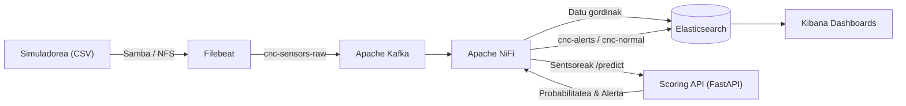

# 🏭 CNC Guard — Mantentze Prediktiboa
### Adimen Artifiziala eta Big Data (AABD) Espezializazio Kurtsoa · 1. Erronka
**Ikasturtea:** 2026 / 2027 &nbsp;|&nbsp; **Eredua:** ETHAZI &nbsp;|&nbsp; **Erakundea:** UNI Eibar-Ermua · Lanbide Heziketa
---
## 📌 1. Testuingurua eta Negozio-Arazoa
**ARAKAIN Makineriak** 50 CNC makina industrial ditu martxan Bilboko fabrika batean. Fabrikan orain arte **mantentze korrektiboa** erabili izan da: makina hautsi arte itxaron, ekoizpena gelditu eta teknikariak konponketa egin arte itxaron.
> ⚠️ **Negozio-inpaktua:** Makina bat gelditzen den ordu bakoitzeko, galerak **1.200 €/orduko** dira.
**Erronkaren Helburua:**  
Datu-ingeniaritza eta Adimen Artifiziala uztartuz, **mantentze prediktiboko sistema integral bat** eraikitzea. Sistemak sentsoreen datuak denbora errealean bilduko ditu, matxurak gertatu aurretik igarriko ditu ML eredu baten bidez, eta mantentze-teknikarientzako alerta-pantailak kudeatuko ditu.
---
## 🏗️ 2. Arkitektura Globala
Sistema bi mundu nagusik osatzen dute: **Irakaslearen Azpiegitura** (fabrikako sentsoreak simulatzen dituena) eta **Ikasleen Stack-a** (Big Data & AI hoditeria osoa).

---
## 🗺️ 3. Lan-Ibilbidea: 3 Fase Nagusiak
Erronkak 4 asteko iraupena du (~45 ordu) eta hiru fase sekuentzialetan banatuta dago:

### 🔹 1. FASEA: Datu-bilketa eta Big Data Pipeline (%35 ·)
* **Filebeat konfiguratu (`filebeat.yml`):** Fabrikako sentsoreen CSV fitxategiak monitorizatu, goiburuak iragazi eta datu-lerro gordinak Kafka-ra igorri.
* **Apache NiFi:** Mezuak kontsumitu, CSV formatua JSONera bihurtu (schema-text Avro erabiliz) eta Elasticsearch-eko indizera bideratu.
* **Kibana Telemetria:** Sentsoreen egoera orokorra ikusteko lehen panela (tenperaturak, biraketa-abiadura, higadura-heatmapeak eta KPIak).
### 🔹 2. FASEA: ML Ereduaren Entrenamendua - Offline (%40 ·)
* **Datu-multzoa:** *AI4I 2020 Predictive Maintenance Dataset* (UCI ML Repository). 8.000 errenkada entrenamendurako.
* **Irteera:** Pipeline osoa (aurreprozesaketa + sailkatzailea) `models/cnc_failure_model.pkl` fitxategian esportatu.
### 🔹 3. FASEA: Eredua Ekoizpenera Eraman eta Alertak (%20 ·)
* **Scoring API (FastAPI):** Python mikrozerbitzu bat garatu. Abioan `.pkl` eredua kargatuko du eta `/predict` bidez jasotako sentsore-datuei probabilitatea eta alerta-maila esleituko dizkie:
  * 🟢 **OK:** Arrisku txikia (< %50)
  * 🟡 **KONTUZ:** Arrisku ertaina (%50 – %80)
  * 🔴 **LARRIA:** Apurketa berehalakoa (> %80)
* **NiFi Integrazioa:** Ereduari galdetu, eta datuak dagokien indizera bideratu.
* **Kibana Alerta Zentroa:** Larrialdi-taulak, probabilitate-gaugeak eta joera-grafikoak sortu mantenu-lanak gidatzeko.
---
## 🧰 4. Zerbitzuen Erreferentzia eta Sarbideak
Ikasle talde bakoitzak ingurune isolatu bat du Docker bidez:
| Zerbitzua | Helburua | Sarbidea | Kredentzialak |
|---|---|---|---| 
| **Samba** | CSV fitxategiak Smart Factory-tik | \\192.168.75.150\cnc-stream | Gonbidatua (Guest / Anonimoa) |
| **Apache NiFi** | Datuen ETL eta bideratzea | `https://localhost:8443/nifi` | `admin` / `adminpassword123` |
| **Kibana** | Bistaratzea eta kontrol-panelak | `http://localhost:5601` | Sarbide librea |
| **Scoring API** | FastAPI Swagger dokumentazioa | `http://localhost:8000/docs` | Sarbide librea |
| **Elasticsearch** | Datu-base dokumentala | `http://localhost:9200` | Sarbide librea |
| **Apache Kafka** | Mezularitza bufferra | `kafka:9092` (Docker barnea) | Barne-erabilera |
---
## 👥 5. Taldeak eta Erakundearen Egitura
Erronka hau erakundeko 5 talde espezializatuk garatzen dute aldi berean:
* 📁 **T1-erronka1**
* 📁 **T2-erronka1**
* 📁 **T3-erronka1**
* 📁 **T4-erronka1**
* 📁 **T5-erronka1**

Talde bakoitzak bere GitHub biltegia du esleituta bere aurrerapena, commit-ak eta kodearen bertsio-kudeaketa aurrera eramateko, erakundeko proiektu-taulari (Kanban / Gantt) zuzenean lotuta.
---
## 📊 6. Ebaluazioa eta Entregagarriak
| Atal Ebaluagarria | Pisua (denboran) | Gakoak |
|---|---|---|
| **1. Fasea — Big Data Pipeline** | **% 35** | Filebeat eraginkorra, NiFi fluxu garbia, ES indexazioa, Kibana 1. panela. |
| **2. Fasea — ML Entrenamendua** | **% 40** | EDA justifikatua, klase-desorekaren kudeaketa, Recall balioak, kode garbia. |
| **3. Fasea — Ekoizpena eta Integrazioa**| **% 20** | FastAPI zerbitzaria, NiFi HTTP integrazioa, alerta-sistema automatizatua. |
| **AI Agenteen Erabilera** | **% 5** | Prompt ingeniaritza eta laguntza-tresnen erabilera kritiko eta arduratsua. |
> 🎁 **Puntu Gehigarriak (+5):** Feature engineering berritzailea, eredu anitzen benchmark-a (RF vs XGBoost), makina bakoitzaren estatistikak bereizturik erakustea multzoan beharrean edo APIaren proba automatizatuak (`pytest`).
### 🎤 Amaierako Defentsa (10 minutu taldeko)
1. **Live Demo (2 min):** Simuladorearen datuak Kibanan mugitzen erakutsi.
2. **Data Science Justifikazioa (3 min):** Hartutako erabakiak, metrikak eta Recall-aren garrantzia azaldu.
3. **Alerta-Simulazioa (2 min):** `LARRIA` mailako egoera baten aurrean sistemaren erantzuna bistaratu.
4. **Galderak eta Ingeniaritza-Irizpidea (3 min):** Irakasleen galderei erantzun.
